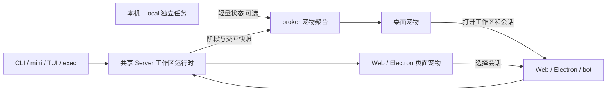

# Omni 宠物：设计、实现与进度

创建日期：2026-10-26。本文是本功能的设计和实施记录；开发过程中在本文件更新状态、实际实现与验证结果。

## 1. 用户目标与范围

用户要求实现宠物，并能与 Omni 的 bot、CLI、mini、TUI、Electron 和 Web 联动。先写详细设计文档，后续按实际完成情况标记进度。

第一版交付一个可常驻、可交互、能跟随真实任务的宠物。宠物使用现有 Omni 会话与工具执行能力；动画本身不调用模型。保留现有快速输入、完整对话、审批、提问、截图和附件流程。

### 功能范围

- 桌面：独立透明置顶宠物窗口，支持拖动、隐藏、恢复、打开 bot、查看任务、跳转正确会话。
- Web/Electron 对话页：显示同一宠物，支持任务状态、当前会话跟随、任务选择和显示开关。
- CLI/mini/TUI/exec：共享 Server 上运行的任务驱动桌面和网页宠物；终端正文、输入框、JSON 输出不增加图形刷新。
- `--local`：独立进程执行保持原语义，增加可选的本机状态广播；广播失败不影响任务。只向已运行的本机共享服务报告状态，不为了动画启动额外模型或改变执行归属。
- 形象：内置 Omni 原创宠物；支持导入兼容 Codex 的透明 PNG/WebP 精灵图。OpenAI 官方形象可作为用户提供的素材导入，默认发行包使用原创素材。
- 多任务：自动选择需要用户输入的任务，其次失败、完成未读、执行中的任务；可固定跟随一个会话。
- 可访问性：有文字状态、键盘按钮、减少动态效果支持；宠物开关可持久保存。

### 第一版不扩展的范围

实体 ESP32 小屏、硬件协议、养成系统、独立聊天模型、素材市场、自动读取剪贴板、终端内 Kitty/Sixel 图片渲染不属于本次交付。终端任务与桌面宠物联动不依赖终端图片能力。

## 2. 调研依据与现有基础

### HachimoDock

调研快照：`YizhengWw/HachimoDock`，提交 `fb30497cebc0ef40fa75125c6dbf6c498db6015d`。

- 内置西高地形象是按状态分类的动画视频，定义在 `pc/src/lib/builtin-appearances.js`。
- `firmware/main/pet_p4_behavior.c` 将生命周期映射到动画，并轮换 idle/working 动作。
- `pc/src-tauri/src/codex_import.rs` 支持 8 列、每格 192×208 的精灵图；v1 为 9 行，v2 为 11 行，前 9 行共用动作。为了小屏播放而切帧、转视频。
- Agent 状态来自日志、Hooks、网关等适配器。Omni 自身已有运行事件，可以直接使用明确的事件与会话 id。
- 当前项目采用自定义非商业源码许可，对独立产品使用也有限制。本文只参考机制，实施不拷贝其实现或内置视频。

### OpenAI 宠物格式

2026-10-26 已读取官方说明和 `openai/codex` 的 `codex-rs/tui/src/pets/{catalog,asset_pack,model}.rs`，并下载、解码检查官方八款素材。

- v1 精灵图：1536×1872，8×9 网格，每格 192×208；v2：1536×2288，8×11 网格。
- 前 9 行依次对应 idle、向右跑、向左跑、招手、跳跃、失败、等待输入、工作、完成/待查看。
- `pet.json` 可以指定 id、displayName、spritesheetPath；第一版上传图像时由 Omni 生成受控元数据，不执行宠物包内脚本。
- 官方代码与 CDN 图像的分发方式不同，尚未确认图像独立再分发许可。发行包采用原创形象；导入功能只处理用户主动提供的图像。

参考：

- <https://github.com/YizhengWw/HachimoDock>
- <https://learn.chatgpt.com/docs/pets>
- <https://github.com/openai/codex/tree/main/codex-rs/tui/src/pets>

### 已确认的 Omni 基础

| 位置 | 已有能力 | 本次复用方式 |
| --- | --- | --- |
| `electron/main.cjs` | 透明置顶 bot、托盘、工作区连接、事件监听、会话跳转 | 增加独立宠物窗口，继续使用现有 bot 打开对话 |
| `electron/preload.cjs` | 隔离页面与 Node 的受控 IPC | 宠物操作提供专用桥接，校验调用页面 |
| `src/server/broker.ts` | 工作区隔离、认证、聚合运行与待处理请求 | 聚合宠物快照，接收本机独立任务的轻量状态 |
| `src/web/state.ts` | SSE 广播、事件缓冲、运行/审批/提问登记、重连快照 | 派生宠物状态，不保存正文到宠物数据 |
| `src/web/events.ts` | 思考、工具、回答、审批、提问、结束事件 | 增加独立于可见思考正文的任务阶段 |
| `src/server/terminal.ts`、`src/exec.ts` | 终端通过共享 Server 执行 | 自然进入同一宠物状态源 |
| `scripts/web-sync.mjs` | 静态资源嵌入单文件产物 | 同步宠物页面、样式与播放器 |

## 3. 形象与视觉设计

### 内置原创宠物

设计一个小巧、圆润的 Omni 猫型伙伴：大眼睛、耳朵、短爪和尾巴，胸前有 O 形标记。采用 SVG 与 CSS 动画，保持透明背景，亮暗主题均有轮廓辨识度。图形由仓库源码绘制，无远程图片依赖。

动作与真实状态对应：

| 状态 | 动作与文字 |
| --- | --- |
| idle | 呼吸、眨眼、尾巴摆动；“陪你一起工作” |
| thinking | 侧头、注视、思考点；“思考中” |
| working | 小爪打字/工作节奏；“执行工具” |
| answering | 注视用户、说话节奏；“正在回答” |
| needs-input | 招手、问号；“需要你处理” |
| ready | 小跳/亮起完成标记；“完成，点击查看” |
| blocked | 困惑表情；“任务遇到问题” |
| disconnected | 静态/轻微休息姿态；“服务未连接” |

摸宠物的反馈是短暂装饰动作，不改真实任务状态；动画结束后回到当前任务动作。减少动态效果时保持状态对应的静态姿态。

### 导入精灵图

导入入口接收 PNG/WebP（最多 20 MiB）。校验真实图像头、尺寸与受支持网格，使用服务端生成的 id/文件名和相对资源 URL。状态选择对应动作行，按照各行动作帧数与时长播放。

第一版使用前 9 行；v2 的额外方向注视帧可被保存但暂不用于跟随。缺少某状态时使用对应通用 working/idle 动作。缩放保持比例并留透明边距。

## 4. 统一状态设计

### 数据路径



宠物状态只是任务投影。动画刷新不写入聊天历史，不增加工具调用，不重新执行任务。

### 每会话状态

使用 workspace id/url 与 session id 组成稳定键，避免两个目录里相似标题产生串会话。记录：

- sessionId、标题、工作区、来源（shared/local）。
- 当前阶段、是否运行、待处理交互数量、更新时刻。
- 当前运行的工具集合，按工具 seq/callId 配对；并行工具返回一项时仍保留其它运行项。
- 结束原因、完成/失败未读标记、读取水位。

状态保持有界，只保留必要的活动与近期结束信息。完成未读直到用户打开/确认，不能仅因另一任务开始就永久丢失。

### 生命周期规则

1. 请求准备开始即进入 thinking，不等第一段 reasoning；`showThinking=false` 仍有正确状态。
2. 工具执行进入 working；并行工具通过集合计数。
3. 正文流开始进入 answering。
4. 审批或提问覆盖运行阶段为 needs-input；交互解决后恢复仍在进行的阶段。
5. `run.end.reason=completed` 才表示 ready；aborted 回到 idle；error/max-steps 表示 blocked。
6. 单次工具失败可以被 Agent 修复，不直接把整轮标为 failed。
7. 会话删除清除状态；下一轮开始清理上一轮工具与临时交互。
8. SSE/长轮询重连必须读取权威快照，不能仅依赖客户端恰好收到过哪些事件。

### 汇总与固定跟随

自动模式：needs-input > blocked 未读 > ready 未读 > working/thinking/answering > idle，同级优先最近更新。固定模式只展示选定任务，提供返回自动跟随入口；选定任务删除时回到自动模式。

## 5. 各端交互与实现思路

### 桌面 bot / Electron

- 新建小型透明、无边框、置顶、跳过任务栏的独立窗口，使用受信任工作区下的宠物静态页面。
- 宠物窗口与快速输入窗口分开：宠物常驻时，不要求主对话页保持可见；隐藏 bot 不使宠物消失。
- 启动显示使用非抢焦点方式。透明区域鼠标穿透；宠物和控制区可点击。拖动时限制在显示器可用区域，保存位置，显示器变化后重新校正。
- 点击宠物打开现有快速输入；“查看任务”显示明确标题与工作区，点击打开对应会话。待审批任务通过现有会话审批卡片处理。
- 托盘与页面提供显示/隐藏、形象设置入口；开关、位置持久化到 desktop settings。
- 通过 broker 读取所有工作区的状态；实时订阅与周期快照校正配合，避免短任务和重连丢失。

### Web / Electron 对话页

- 共用轻量 DOM/SVG/精灵图播放器，与已有原生 JS 页面风格兼容，不引入 UI 框架。
- 对话页宠物默认跟随当前会话，可切换自动模式；不遮挡输入、审批卡片或移动端主要操作。
- 设置面板提供宠物开关、原创/导入形象选择、上传与删除；服务端返回受控资源 URL。
- 任务点击复用已有 `switchSession` 等会话导航；浏览器页面不模拟原生桌面置顶能力。

### CLI / mini / TUI / exec

- 共享模式使用同一运行态，无须为每种终端增加动画输出。
- headless text/json/stream-json stdout 继续只遵循现有协议。
- 可通过顶层 `omni pet` 命令查看状态、唤起桌面宠物/设置显示；具体命令在实现后补充实际用法。
- `--local` 广播独立于任务执行：只发现已经运行的本机 broker、限制请求超时、合并高频阶段更新、租约心跳、进程退出/租约失效清理。
- local 任务仍由终端处理审批；宠物提供提醒和工作区/会话定位，不伪装成可以接管独立进程的执行客户端。

## 6. 安全、性能与分发

- 宠物接口沿用共享服务认证和同源边界，IPC 校验 sender，渲染器不持有 broker token。
- 宠物上传不执行脚本，不接受任意远程 URL 或任意文件读取路径；图片和 manifest 名称限制，服务端校验尺寸/体积。
- 宠物状态不包含 API key、环境变量、工具参数或思考正文；标题显示沿用脱敏和文本节点渲染。
- 动画仅在可见时运行；关闭/隐藏后释放监听和计时器，减少动态效果时使用静态帧。
- 不从终端额外打印状态；local 广播失败不改变退出码或任务结果。
- 浏览器资源进入 `web:sync`，Electron 打包沿用 web/electron 文件列表。CLI 单文件可提供宠物状态接口，桌面悬浮显示仍需要 Electron 应用。

## 7. 文件与接口规划

以下为实施规划，实际文件/路由落地后在第 9 节补充变化。

| 模块 | 规划职责 |
| --- | --- |
| `src/pet/state.ts` | 状态类型、生命周期、工具集合、优先级、未读与快照 |
| `src/pet/presence.ts` | 本机独立任务的轻量广播和租约 |
| `src/web/pet.ts` | 宠物设置/素材存储、上传校验、资源响应 |
| `src/web/state.ts` / `server.ts` | 工作区宠物状态投影、API、重连快照 |
| `src/server/broker.ts` | 跨工作区快照与 local presence 接入 |
| `web/pet.js` / `pet.css` / `pet.html` | 共享播放器、控制界面、独立宠物页 |
| `electron/pet-utils.cjs` / `main.cjs` / `preload.cjs` | 原生窗口、拖动/穿透、设置和会话动作 |
| `src/cli/pet.ts` / `index.ts` / CLI help | 宠物状态与桌面唤起入口 |
| `scripts/probe-pet.ts` | mock 跨端验收与重连测试 |

新增宠物状态与设置接口必须有明确版本、校验与有界返回，不改变现有冻结的 headless 事件格式。

## 8. 实施进度

状态含义：待做 / 进行中 / 已实现待验证 / 已验证 / 有限制。只有完成对应检查才标为已验证。

| 编号 | 任务 | 状态 | 完成依据 |
| --- | --- | --- | --- |
| P0 | 调研现有代码、写设计和实施记录 | 已完成 | 本文；源码位置与设计边界已记录 |
| P1 | 统一状态、阶段事件、并行工具、未读与重连快照 | 已验证 | 状态单测、关闭思考/审批/提问/取消/步数上限/重连探针通过 |
| P2 | 跨工作区汇总与 `--local` 状态广播 | 已验证 | 两个真实工作区、聚合 SSE 与独立 CLI JSON 输出验收通过 |
| P3 | 原创宠物、动作播放器与精灵图导入 | 已验证 | SVG 小猫实渲染、PNG v1/v2 API 导入、WebP 浏览器上传/播放通过 |
| P4 | Web/Electron 页面宠物、设置与会话操作 | 已验证 | 上传/删除等待快照、页面隐藏恢复、亮暗主题与 390px 窄屏通过 |
| P5 | 桌面宠物窗口、bot 联动、拖动/穿透与持久化 | 已验证（macOS） | 实际两窗口、不抢焦点、指针拖动、命中穿透、会话展开与隐藏恢复通过 |
| P6 | CLI 入口、资源同步与使用文档 | 已验证 | pet 帮助/status 与实际 Electron 宿主路径通过，web:sync/build 完成 |
| P7 | mock 跨端验收、浏览器视觉检查、桌面检查 | 已验证（macOS/mock） | 宠物探针 26 项；桌面 20/20、单元 120/120、共享服务 21 项、Web 探针通过 |
| P8 | 完整必要回归、最终进度和限制记录 | 已完成 | 最终 typecheck/build、资源同步、TUI 快照与 diff 检查通过；平台限制见下文 |

### 验收清单

- [x] 空闲/请求准备/思考/工具/回答/完成/失败/取消动作正确（状态单测与 mock；失败包括 max-steps）。
- [x] 关闭思考文字后仍显示思考阶段。
- [x] 多工具并行不会因单项完成提前变空闲（状态单测）。
- [x] 审批与提问优先，处理后恢复正确状态。
- [x] CLI 发起任务，bot/Web/Electron 宠物能跟随同一工作区会话。
- [x] 另一个工作区任务被聚合；路由和动作匹配通过探针/桌面回归。
- [x] 重连快照恢复状态和未读，不重发旧任务；不声称恢复已经退出的运行进程。
- [x] `--local` 独立任务可被观察，JSON stdout 不受影响；无服务 status/入口通过。
- [x] 原创宠物亮暗主题、390px 窄屏、减少动态效果可用。
- [x] PNG v1/v2 API 导入与真实 WebP 浏览器上传/选用/删除通过；非法图像拒绝。
- [x] macOS 桌面指针拖动、位置保存和下次启动读取、透明区域命中穿透、隐藏恢复、点击唤起 bot 可用。
- [x] 宠物不增加模型调用，不写聊天正文，headless stdout 保持单一 JSON。
- [x] typecheck/build、资源同步、相关既有探针和 TUI 快照通过。
- [ ] Windows/Linux 真机交互验收（本次环境为 macOS，Linux 穿透能力见平台限制）。

## 9. 实施记录与测试证据

### 2026-10-26：设计落盘

- 用户明确要求先写文档，再边实现边标记进度。
- 已读取当前 bot、共享 broker、Web 状态/事件、终端适配和资源同步代码。
- 当前工作区基线 `package.json` 为 0.9.8；开始实施前工作树干净。
- P0 已完成。后续在此追加每批改动、设计调整和具体测试结果。

### 2026-10-26：状态与素材实现

- 新增 `src/pet/state.ts`：状态投影、工具与交互集合、自动优先级、完成水位和有界历史。采用已有 `turn.step` / `user.message` 驱动准备/思考状态，因此无需为思考正文关闭新增 LLM 事件。
- `src/web/state.ts` 在实际状态变化时发 `pet.changed`；`/api/pet` 返回权威状态，`/api/snapshot` 带宠物快照。
- `src/pet/presence.ts` 对独立终端的 Output 做轻量观察，AsyncLocalStorage 隔离审批/提问，心跳合并更新；网络请求超时 400ms，运行租约 15 秒，结束记录保留 15 分钟。只访问已有 broker，可用 `OMNI_PET=off` 禁用。
- `/_omni/pet` 汇总工作区与独立任务；`/_omni/pet/events` 只发变化提示。原有 stdout/headless 事件不增加宠物行。
- `src/web/pet.ts` 在全局配置目录 `omni/pets/` 保存偏好、受控图像和 manifest，文件原子写入。上传校验格式头、尺寸和大小，前端同时实际解码；不执行用户素材中的脚本。
- 原创形象为源码 SVG 小猫，胸前使用编织 O 的简化图形。导入精灵图直接定位透明帧，不转视频。

### 2026-10-26：页面与桌面实现

- `web/pet.js` / `pet.css` / `pet.html` 共用播放器、状态、任务列表和原生桥接。减少动态效果时停止 CSS/精灵图动画，隐藏图像暂停帧计时。
- Web/Electron 侧栏提供“宠物”；页面默认跟随当前会话，任务列表可回到自动模式。窄屏采用标题栏里的小图标，不占正文；bot 对话页隐藏重复宠物，由独立窗口显示。
- `electron/pet-preload.cjs` 仅提供状态与受控动作，主进程严格校验宠物页面与 senderFrame。宠物点击唤起快速输入，任务点击展开对应会话；跨工作区动作必须匹配实际聚合任务。
- 原生宠物窗口 240×286，透明置顶、跳过任务栏，非抢焦点显示；位置存于桌面偏好。SVG 依据实际图形命中，精灵图依据当前帧 alpha 命中。
- **平台调整**：安装的 Electron 43.4.1 类型说明明确 `forward` 仅支持 macOS/Windows。Linux 使用可点击窗口，避免启用穿透后无法恢复鼠标事件。Windows/Linux 尚未真机验收。
- **实际检查发现并修复**：宠物任务点击原先只显示 compact 输入框，改为展开原对话；设置刷新原先在并发 GET 时提前返回，改为共享刷新 Promise，删除/导入后等待最新快照；减少窄屏占用；修正精灵图非整数缩放的行偏移和主题选择器。

### 已执行验证（最终记录）

| 检查 | 结果 | 实际覆盖 |
| --- | --- | --- |
| `npm test` | 120/120 通过 | 状态、租约、图像头校验与既有单元回归 |
| `npm run test:desktop` | 20/20 通过 | 现有 bot/截图/草稿、宠物窗口与 IPC、Linux 可点击回退 |
| `npm run probe:pet` | 26 项通过 | 真 broker、两工作区、审批/提问、取消、max-steps、快照、独立 CLI JSON、PNG v1/v2 导入选择删除 |
| `npm run probe:bot` | 21 项通过 | 共享服务与远程认证、并发、待处理请求恢复等既有回归 |
| `npm run probe:web` | 全部通过 | 现有 Web 工具、会话与取消/审批/提问回归 |
| 浏览器实渲染 | 主流程通过 | 原创小猫、暗色模式、真实 WebP 上传播放、减少动态效果静态帧 |
| macOS 开发 Electron | 主流程通过 | 实际原生宠物与 bot 两窗口，不抢焦点、透明角穿透/猫身接收、指针拖动、位置保存、点击展开会话、隐藏恢复 |
| `npm run web:sync` + `npm run build` | 通过 | 最终静态资源嵌入、strict typecheck、tsc 与单文件 bundle |
| `npm run tui:snapshot` | 全部通过 | 既有 51 场景及子场景回归；未在终端内新增图片绘制 |
| `git diff --check` | 通过 | 无补丁空白错误 |

实际截图和本地桌面验收脚本保存在被忽略的 `.omni/pet-qa/`，不混入发行素材。正式产品不包含调研下载的 OpenAI 图像。

### 最终范围与限制

- macOS 使用开发 Electron 43.4.1 实际启动、截图和操作验证；安装包尚未打包签名/公证或发布。本地验收完成后，用户于 2026-10-26 授权将本次源码与设计文档提交并推送到 `origin/main`。
- Windows/Linux 的窗口与 IPC 实现已落地，自动化桌面回归通过；本次没有这两个系统的真机。Linux 因 Electron 不支持 forward 鼠标移动消息，保留整个窗口可点击，不提供透明像素穿透。
- 独立终端的联动覆盖 Agent 回合；状态投影不会接管原终端审批。进程异常消失时运行租约 15 秒后清理，结束状态保留 15 分钟。
- 共享运行状态和未读在当前 worker 生命周期中保存；网络重连读取权威快照。进程重启后不恢复已经中断的任务执行。
- 终端内 Kitty/Sixel 宠物图形、实体小屏、形象市场与养成系统不在本次范围。
- 更新已经运行的旧版本共享服务时，需要在任务空闲后停止旧服务，再启动本次代码。旧进程不会因构建自动热替换。

截图：`.omni/pet-qa/desktop-pet.png`、`desktop-bot-session.png`、`web-imported-sprite.png`、`web-mobile-final.png`。本次 WebP 为调研临时下载的 OpenAI 形象，仅用于兼容验收；已从测试服务删除。

## 10. 交付使用说明

源码启动：

```bash
npm run dev -- pet                 # 只唤起宠物，bot 输入框保持隐藏，点击宠物再打开
npm run dev:bot                    # 同时打开 bot 快速输入与宠物
npm run dev -- pet hide            # 隐藏宠物
npm run dev -- pet status          # 已有共享服务的任务 JSON，不启动模型
npm run dev -- help pet            # 用法
npm run probe:pet                  # 离线跨端验收
```

安装相应新版本后使用 `omni pet` / `omni pet show|hide|status`。只有 CLI 安装包时需另有桌面应用；可用既有 `OMNI_DESKTOP_PATH` 指定桌面宿主。源码 checkout 会使用本仓库的 Electron。

- 默认显示原创小猫。点击宠物唤起 bot；“任务”列出标题/工作区，点击进入并展开原对话。多会话自动模式优先提醒需要审批或回答的任务。
- 拖动猫身移动，位置自动保存；托盘“显示宠物”控制显示/隐藏，“宠物形象…”打开设置。
- Web/Electron 侧栏“宠物”设置页面显示开关和形象。主动选择 PNG/WebP 后自动导入并选用；删除选用形象会回退原创小猫。桌面设置还提供独立的原生宠物开关。
- 通过同一共享 Server 运行的 CLI/mini/TUI/exec/Web/Electron 任务会同步到桌面宠物。页面宠物默认跟随当前会话，可在任务列表中返回自动模式。
- `--local` 仍由本机进程独立执行，只有已有 broker 时报告轻量状态；`OMNI_PET=off` 关闭广播。审批和提问仍需原终端处理。
- 本机桌面验收可以设置 `OMNI_DESKTOP_USER_DATA_DIR` 使用独立测试偏好和单实例锁；正常使用不需设置。
