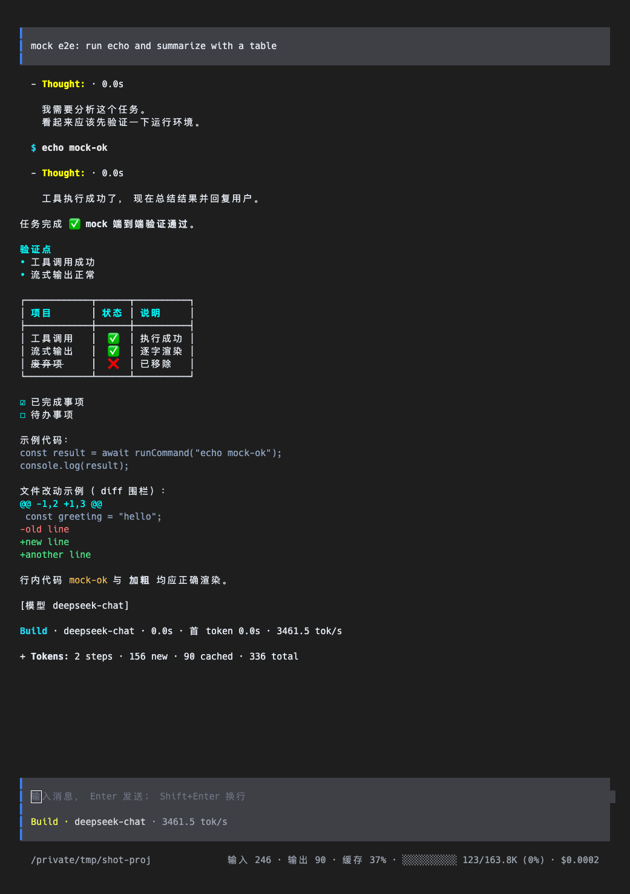
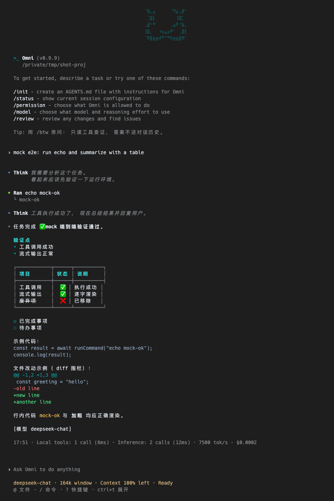

# Omni

[English](README.md) | [中文](README.zh-CN.md)

 [](LICENSE)

Omni 是一个终端型 AI 编程助手：读代码、改文件、跑命令，用自然语言完成编程任务——每一步都有安全护栏。




## 快速开始

1. 安装（三选一）：

```bash
# 原生二进制，零依赖（含完整 TUI）
curl -fsSL https://raw.githubusercontent.com/jacksonon/omni/main/scripts/install.sh | sh

# 或：npm 包（命令行模式，需 Node >= 18）
npm install -g ./omni-<version>.tgz   # 经 `npm pack` 构建
```

2. 配置 API Key（兼容所有 OpenAI 协议的服务端点）：

```bash
export OMNI_API_KEY=sk-xxx
export OMNI_BASE_URL=https://api.deepseek.com/v1   # 可选，默认 OpenAI
```

3. 运行：

```bash
omni "介绍一下这个目录的结构"   # 单次任务
omni                             # 交互会话
```

没有 Key？`npm run mock` 可启动本地 mock API，无 Key 端到端验证。

## 运行模式

| 命令 | 说明 |
|---|---|
| `omni` | 全屏 TUI：可滚动历史、Markdown 渲染、可点击展开的工具卡片、`/` 命令 + `@` 文件提及 |
| `omni mini` | 纯终端 CLI（Codex CLI 风格）：同一套运行时，普通滚动行，`Ctrl+T` 查看完整轨迹 |
| `omni exec "<任务>"` | Headless 模式（脚本/管道/CI）：stdout 只出结果（`--output-format text\|json\|stream-json`） |
| `omni web` | 本地后端（REST + SSE）+ 浏览器界面，多会话侧栏 |
| 桌面应用 | 独立 Electron 应用（mac/win/linux），见 GitHub Releases，无需 Node |

## 评测数据

本仓库实测（可复现，非厂商宣传）：

```bash
npx tsx scripts/eval/run-headless-eval.ts --real --repeat 5
```

模型 `deepseek-v4.1-flash`（OpenRouter 快照单价：输入 $0.15 / 输出 $0.6 / 缓存 $0.003 每 1M）· 2026-10-12 · 3 个冒烟任务 × 5 次：

| 任务 | 通过 | 时长 p50/p90/p99 | TTFT p50/p90/p99 | 平均 token | 平均成本 |
|---|---|---|---|---|---|
| 回答身份 | 5/5 | 2535/4008/4008ms | 2430/3872/3872ms | 16,654 | $0.0006 |
| 算术+工具 | 5/5 | 2926/3360/3360ms | 2261/2625/2625ms | 16,727 | $0.0001 |
| 读文件+回答 | 5/5 | 6893/7415/7415ms | 2155/3106/3106ms | 36,126 | $0.0003 |
| **合计** | **15/15** | 3171/7224/7415ms | 2277/3106/3872ms | 347,534 | **$0.0003/次** |

说明：N=5，p99 即最大值，按"观测到的最坏情况"理解。成本大头被缓存吃掉：热命中（99% 缓存）单次约 $0.00006，冷启动约 $0.0025（差 ~40 倍）。之前 hanging 是评测 runner 的 bug（超时只杀 `npx` 壳、真进程继续跑），已改为进程组 kill。

外部对照（任务/harness 不同，仅供参考）：Berkeley [HarnessTax 研究](https://arena.ai/blog/coding-agents-harness-tax)（2026-09，21 组模型×harness）发现 harness 主要影响成本而非正确率（成功率 ±2–5%，成本差可达 ~2 倍：Claude Code ≈ 2.0× Pi、≈ 1.6× Codex CLI，SWE-bench Lite）——Omni 走极简路线的原因。Terminal-Bench 榜单（[tbench.ai](https://www.tbench.ai/)）：Claude Code + Opus 5.5 为 64.8%。

## 特性

- **Agent 主循环**：流式调模型 → 并行执行工具 → 结果回传；失败信息回传给模型自我修正
- **工具集**：文件读写改（`read`/`write`/`edit`）、`search_code`、`run_command`、`skill`、`lsp` 导航，+ 运行时工具（`delegate` 子代理、MCP、`web_fetch`/`web_search`、`ask_user`、Team 看板）
- **安全优先**：权限分级（`full`/`safe`/`ask`/`read`）、危险命令确认、审批 UI、审计日志、工作区信任、OS 级沙箱
- **记忆与会话**：`AGENTS.md` 项目/全局记忆级联、JSONL 会话持久化（恢复/分叉/回滚）
- **多模型**：`providers` 分组（一个网关挂多模型）、`/model` 切换、Completions + Responses 双协议、思考级别
- **可扩展**：MCP 服务器、生命周期 hooks、技能、插件、Headless `exec`/`mcp-server` 进 CI

## 配置

JSON/JSONC，优先级：默认值 → 全局（`~/.config/omni/omni.json`）→ 项目（`omni.json`）→ 环境变量 → CLI 参数。

```jsonc
{
  "model": "deepseek-chat",
  "permission": "safe",
  "providers": {
    "bigmodel": { "baseURL": "https://open.bigmodel.cn/api/paas/v4", "apiKey": "{env:GLM_KEY}",
      "models": { "glm-4-flash": {} } }
  }
}
```

完整字段说明见 [`omni.example.jsonc`](omni.example.jsonc)。

## 文档

| 文档 | 内容 |
|---|---|
| [`Doc/使用指导.md`](Doc/使用指导.md) · [`Doc/Usage-Guide.md`](Doc/Usage-Guide.md) | 用户手册（安装、命令、MCP、hooks、技能、FAQ） |
| [`Doc/架构.md`](Doc/架构.md) · [`Doc/architecture.md`](Doc/architecture.md) | 逐模块架构说明 |
| [`Doc/Headless-Protocol.md`](Doc/Headless-Protocol.md) | Headless `exec` / `mcp-server` 协议 |
| [`Doc/roadmap.md`](Doc/roadmap.md) | 路线图 |

## 开发

```bash
npm run dev -- "<任务>"   # 源码运行（tsx）
npm run typecheck         # 类型检查
npm run build             # 类型检查 + 编译 + 打包
npm run eval:mock         # 离线评估（确定性，可进 CI）
```

## 许可证

[BSD-3-Clause](LICENSE)。
